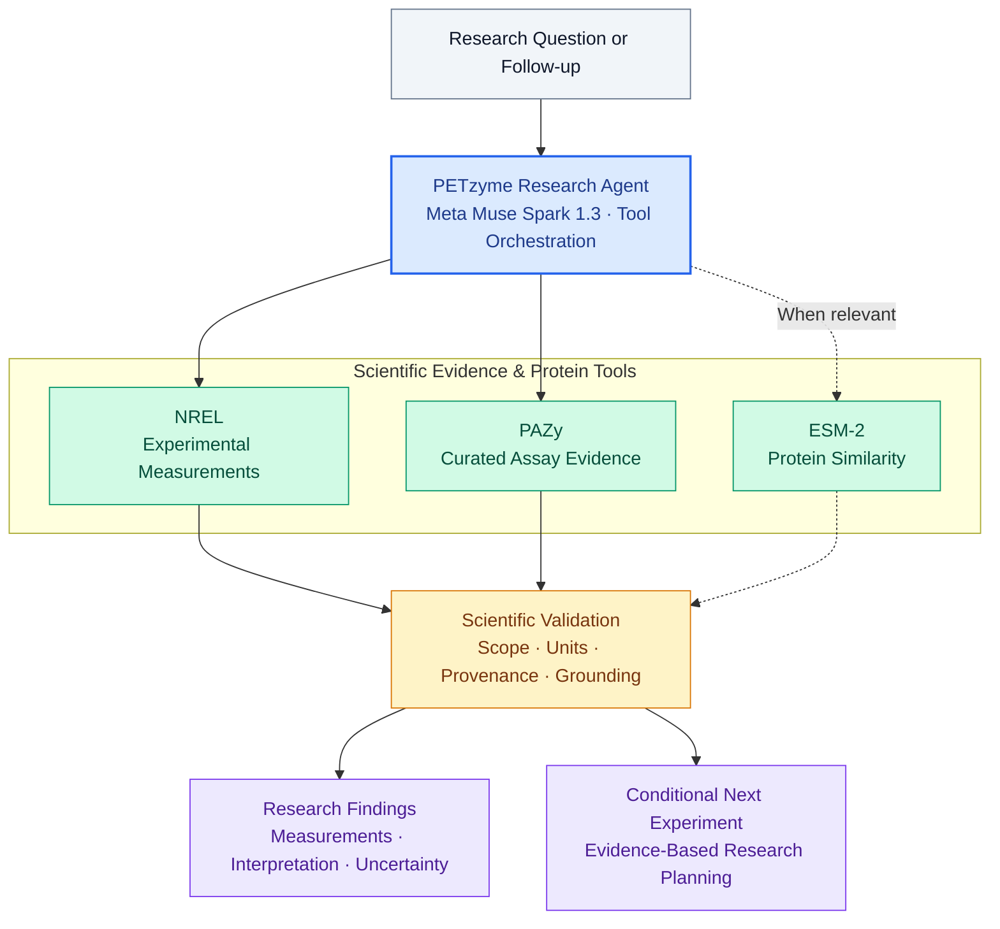

# PETzyme

**An AI research assistant for PET-degrading enzyme discovery and evidence-grounded experimental planning.**

Finding promising enzymes for plastic recycling requires more than comparing reported activity values. Experimental measurements come from different studies, substrates, temperatures, pH conditions, and protocols. Without that context, comparisons can be misleading.

**PETzyme** brings these measurements into an interactive research workflow. Powered by **Meta Muse Spark 1.3** and deterministic Python scientific tools, it helps researchers investigate PET-degrading enzymes, evaluate experimental evidence, and identify useful next experiments.

Unlike a conventional passage-retrieval chatbot, PETzyme operates on structured experimental records. Muse selects scientific tools and supporting evidence, while Python handles calculations, provenance checks, scientific validation, and grounded result presentation.

The goal is simple: **turn scattered experimental evidence into research decisions that scientists can inspect and test.**

## How PETzyme Works



Muse orchestrates scientific investigations; the underlying Python tools execute evidence retrieval, calculations, and validation. A deterministic offline workflow is also available without an LLM.

## What PETzyme Can Do

- **Investigate enzymes.** Retrieve NREL and PAZy experimental measurements with their temperatures, pH, PET forms, responses, units, and source references.
- **Evaluate evidence.** Identify missing conditions, assess comparability, and recognize when different database entries originate from the same publication.
- **Explore protein sequences.** Triage enzyme names and sequences using local protein tools, including ESM-2 representation similarity.
- **Plan experiments.** Suggest conditional follow-up experiments based on reported evidence and researcher-supplied laboratory constraints.
- **Maintain research context.** Continue investigations across questions, change evidence sources, and refine experimental conditions.

### An example of why provenance matters

In one ESM050 investigation, PETzyme identified **16 retrieved PAZy assay records associated with the same underlying NREL publication**.

Although the measurements appeared in multiple data resources, they did not constitute independent replication.

This distinction matters when deciding how much confidence to place in an experimental finding.

## Try Asking PETzyme

> Investigate ESM050. What experimental results have been reported, and what should I test next?

> Show NREL evidence for ESM050 at 60°C.

> Which five enzymes have high recorded PET-degradation responses under comparable assay conditions?

> My laboratory supports only 40°C and pH 7 or lower. What experiment should I consider next?

## Scientific Grounding

PETzyme separates experimental evidence from computational interpretation and proposed actions.

| Evidence class | Meaning |
|---|---|
| **MEASURED** | Experimental observations retrieved with their source and assay conditions |
| **COMPUTED** | Quantities derived by scientific tools, including explicitly qualified unit conversions |
| **HYPOTHETICAL** | Conditional experimental proposals, not validated protocols or predicted outcomes |

The scientific layer also checks for unsupported comparisons, missing measurements, source overlap, and unverified enzyme identities.

**Known limitations:** The condensed NREL CSV does not explicitly declare its response unit. Eligible converted values are therefore labelled *inferred/computed*, while original observations remain available. PAZy values retain their source-reported units. Cross-source construct identity and quantitative comparability are not assumed without supporting evidence.

PETzyme does not establish enzyme superiority, predict PET-degradation activity, prove causality, or replace laboratory validation. ESM-2 similarity is a representation-based comparison, not an activity measurement.

## Getting Started

### Requirements

- Python 3.11
- macOS with Apple Silicon for the verified dependency environment
- Internet connection for initial scientific resource preparation
- Meta Muse credentials for optional live agent execution

The scientific tools also support deterministic offline operation without Muse.

### 1. Install dependencies

From the repository root:

```bash
python3.11 -m venv .venv
.venv/bin/python -m pip install -r requirements-macos-py311.lock
```

The supplied dependency lock reflects the verified release environment. Other platforms may require separate dependency resolution.

### 2. Prepare scientific resources

The repository does not bundle scientific datasets or pretrained model weights.

Use the preparation scripts to acquire and verify the pinned resources:

```bash
# NREL experimental measurements
.venv/bin/python -m scripts.prepare_nrel

# PAZy experimental activity data
.venv/bin/python -m scripts.prepare_pazy_activity

# Optional: local ESM-2 model
.venv/bin/python -m scripts.prepare_esm2
```

These scripts use the official sources, verify resource integrity, and preserve the corresponding provenance manifests.

Data and model assets are stored locally in Git-ignored directories.

### 3. Launch PETzyme

For deterministic offline operation without paid Muse inference:

```bash
PETZYME_OFFLINE=1 HF_HUB_OFFLINE=1 \
  .venv/bin/python -m streamlit run streamlit_app.py
```

Open **http://127.0.0.1:8501** in your browser.

For live Meta Muse execution on macOS, configure the application's login-Keychain credential using:

- **Service:** `zymecycle-meta-api`
- **Account:** `zymecycle`

Then launch the application without `PETZYME_OFFLINE=1`.

The launcher supplies the credential securely to the worker process. Never include API credentials in source files or commits. Live inference requires access to Meta's API and may incur usage charges.

## Testing

Run the scientific and integration tests:

```bash
.venv/bin/python -m pytest -q
```

To include real local ESM-2 inference:

```bash
HF_HUB_OFFLINE=1 HF_HUB_DISABLE_TELEMETRY=1 \
  ZYMECYCLE_REAL_ESM=1 \
  .venv/bin/python -m pytest -q
```

The full suite requires the prepared scientific data and model checkpoint.

**Release verification: 1,310 tests passed, zero skipped, including real ESM-2 inference in an isolated environment.**

This validates the tested software behaviors; it does not establish experimental accuracy or guarantee that every possible model-generated tool request will succeed.

## Project Structure

| Component | Purpose |
|---|---|
| `streamlit_app.py` | Researcher-facing interface |
| `zymecycle/` | Scientific tools, agent orchestration, validation, and UI adapters |
| `scripts/` | Resource preparation, launch utilities, and CLI workflows |
| `tests/` | Scientific, agent, privacy, and integration tests |
| `*_MANIFEST.json` | Source provenance and reconciliation |
| `MODEL_PROVENANCE.json` | ESM-2 checkpoint and model integrity |

**PETzyme** is the public project name. The internal Python package retains `zymecycle` for compatibility.

## Scientific Sources

PETzyme builds on published scientific resources:

- **NREL:** Norton-Baker et al., *ACS Catalysis* (2025). [Research article](https://doi.org/10.1021/acscatal.5c03460) · [Experimental dataset](https://doi.org/10.5281/zenodo.15417757)
- **PAZy:** Feuerriegel et al., *Nucleic Acids Research* (2026). [Publication](https://doi.org/10.1093/nar/gkag1026) · [PAZy database](https://www.pazy.eu/)
- **ESM-2:** Meta's pretrained protein language model, [`facebook/esm2_t12_35M_UR50D`](https://huggingface.co/facebook/esm2_t12_35M_UR50D)

Resource versions, checksums, attribution, and relevant source qualifications are documented in the accompanying provenance manifests.

---

**PETzyme — From experimental evidence to the next research question.**
