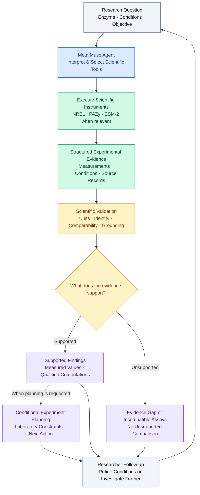

## How PETzyme Works

PETzyme treats an enzyme investigation as a **scientific workflow**, not simply a question-answering task.

Meta Muse helps interpret research objectives and select scientific tools. Python instruments execute the investigation against structured experimental records, while independent validation checks determine which measurements, comparisons, and conclusions are supported.

A deterministic offline route can also execute the scientific workflow without Muse.

### An example: investigating ESM050

In a source-backed investigation, PETzyme identified 16 retrieved PAZy assay records associated with the same NREL publication. Rather than treating their presence across databases as independent replication, PETzyme identifies the shared publication lineage.

It also distinguishes original NREL measurements from values converted using an inferred unit, preserves individual PAZy observations, and qualifies comparisons when experimental equivalence is unverified.

The result is more than a retrieved answer: **an auditable scientific assessment that can inform a conditional next experiment.**
